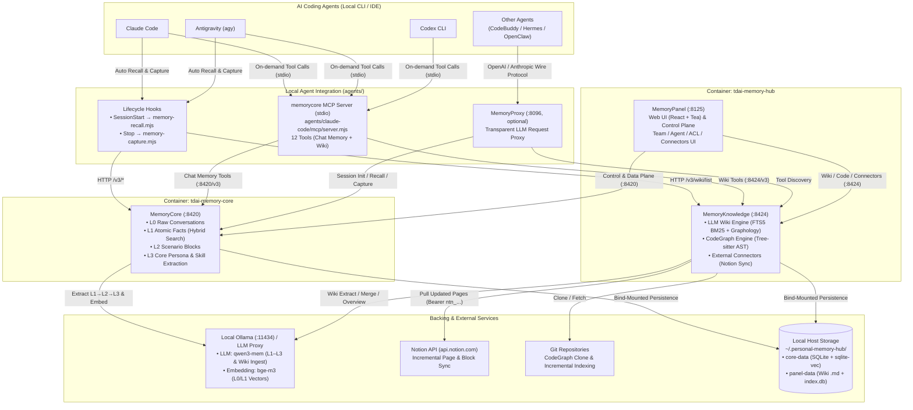

# Personal Memory Hub

**A private, self-hosted long-term memory and knowledge server for AI coding agents.**

Agents forget everything between sessions. **Personal Memory Hub** runs alongside **Claude Code**, **Antigravity**, **Codex**, and other coding agents so they don't: conversations are distilled into layered, searchable memory (`L0`–`L3`), external documents (such as **Notion** or uploaded Markdown) are compiled into **LLM Wiki knowledge graphs**, and every agent you use across editors and CLIs reads and writes the same local store.

[Architecture](#architecture) · [How Agents Interact](#how-claude-code-antigravity-and-codex-interact) · [External & Backing Services](#external--backing-services-used-by-memory-hub) · [Available APIs & MCP Tools](#available-apis--mcp-tools) · [Memory Layers & Wiki Graph](#how-memory--wiki-knowledge-graphs-work) · [Storage Backends](#storage-backends) · [Installation & Development](#installation--development)

---

## Architecture

Personal Memory Hub runs as two core containers on your machine (`tdai-memory-core` on `:8420` and `tdai-memory-hub` on `:8125` + `:8424`), backed by local SQLite/Postgres and a local Ollama (or custom OpenAI-compatible LLM endpoint):



---

## How Claude Code, Antigravity, and Codex Interact

Instead of forcing **Claude Code**, **Antigravity**, or **Codex** through an HTTP LLM proxy (which would override native OAuth/Pro subscriptions), they keep their direct connection to Anthropic / Google / OpenAI and interact with Memory Hub through **Hooks + the unified `memorycore` MCP Server** ([`agents/claude-code/`](./agents/claude-code/README.md) and [`agents/antigravity/`](./agents/antigravity/README.md)):

| Agent | Automatic Lifecycle Hooks | On-Demand MCP Tools (`memorycore`) | Per-Project Isolation |
| :--- | :--- | :--- | :--- |
| **Claude Code** | `~/.claude/settings.json`<br/>• **`SessionStart`** (`memory-recall.mjs`): Injects the current project's **L3 Persona**, **L2 Scenario Index**, and available **Team Wiki list** into `additionalContext`.<br/>• **`Stop`** (`memory-capture.mjs`): Incrementally ships new turns (via UUID cursor) to MemoryCore **L0**. | `~/.claude.json` (`mcpServers.memorycore`)<br/>Exposes all **12 tools** (7 Chat Memory + 5 Wiki) over stdio. | Auto-derives a stable project key from `git remote` / root commit, registers a dedicated MemoryCore `agent_id` per repo, and caches it in `~/.personal-memory-hub/agents.json`. |
| **Antigravity (`agy`)** | `~/.gemini/config/hooks.json`<br/>• **`SessionStart`** (`agents/antigravity/hooks/memory-recall.mjs`): Injects **L3 + L2 Index + Wiki list** via `injectSteps`.<br/>• **`Stop`** (`agents/antigravity/hooks/memory-capture.mjs`): Ships new `USER_INPUT` / `PLANNER_RESPONSE` turns (via `step_index` cursor) to **L0**. | `~/.gemini/config/mcp_config.json` (`mcpServers.memorycore`)<br/>Shares the exact same [`agents/claude-code/mcp/server.mjs`](./agents/claude-code/mcp/server.mjs) stdio server. | Same per-repository `agent_id` registry (`~/.personal-memory-hub/agents.json`), so Claude Code and Antigravity working in the same repo share the same project memory. |
| **Codex CLI** | Optional (or via `MemoryProxy` Responses API). | `$CODEX_HOME/config.toml` (`[mcp_servers.memorycore]`)<br/>Shares the same [`server.mjs`](./agents/claude-code/mcp/server.mjs) stdio server to search/write Chat Memory and query Team Wikis. | Uses `process.cwd()` git identity to resolve the project's `agent_id`, plus supports `agent="<name>"` for cross-project lookup. |

---

## External & Backing Services Used by Memory Hub

Memory Hub coordinates the following local and external services:

1. **LLM Service (Local Ollama `:11434` or Custom OpenAI-Compatible Proxy)**
   - **Used by `MemoryCore` (`:8420`)**: Runs the asynchronous extraction pipeline (`L0 → L1 atomic extraction`, `L1 deduplication`, `L2 scenario block generation`, `L3 persona synthesis`, and `Skill extraction`). Recommended local model: `qwen3-mem` (`qwen3:8b` with 32k context and `temperature=0`).
   - **Used by `MemoryKnowledge` (`:8424`)**: Powers the **LLM Wiki ingest pipeline** (`ingest-v2`) — splitting raw documents into structured `entity`, `concept`, `comparison`, `source`, and `overview` Markdown pages with `[[wikilink]]` cross-references, plus generating the Wiki summary.
2. **Embedding Service (Local Ollama `bge-m3` or OpenAI Embeddings)**
   - **Used by `MemoryCore` (`:8420`)**: Embeds `L0` conversation messages and `L1` atomic facts into `sqlite-vec` (or `pgvector`) for hybrid semantic + BM25 search.
   - *(Note: `MemoryKnowledge` Wiki does **not** require an embedding model; see [How Memory & Wiki Knowledge Graphs Work](#how-memory--wiki-knowledge-graphs-work).)*
3. **Notion API (`https://api.notion.com/v1`)**
   - **Used by `MemoryKnowledge` (`:8424`) Connectors**: Opt-in incremental sync ([`MemoryKnowledge/src/connectors/`](./MemoryKnowledge/src/connectors/)). Uses a Notion Internal Integration Token (`ntn_...`, configurable in the Panel UI at `:8125` and persisted in SQLite `knowledge_connector`) to fetch shared pages, child pages, and database entries, convert Notion blocks to Markdown, and trigger incremental Wiki ingestion when `last_edited_time` or content SHA-256 changes.
4. **Git Remotes (`https://...`)**
   - **Used by `MemoryKnowledge` (`:8424`) CodeGraph Engine**: Clones and incrementally fetches repositories to build a Tree-sitter symbol and call-graph index.
5. **Optional Telemetry & Enterprise Integrations**
   - **ClickHouse** (optional): Usage analytics and tool-call telemetry (`CLICKHOUSE_ENABLED=true`).
   - **LLM Proxy (`MemoryProxy :8096`)** (optional): Wire-protocol gateway for agents that do not use local hooks/MCP.

---

## Available APIs & MCP Tools

### 1. MCP Tools (`memorycore` stdio server — [`agents/claude-code/mcp/server.mjs`](./agents/claude-code/mcp/server.mjs))

Available directly inside **Claude Code**, **Antigravity**, and **Codex**:

| Category | Tool Name | Description |
| :--- | :--- | :--- |
| **Chat Memory (`:8420`)** | `agent_list` | List all registered project memory agents (`agent_id`, `name`, `status`) in the team. |
| | `memory_search` | Hybrid search (BM25 + vector) across **L0** conversations and **L1** atomic memories. Supports `agent="<name or id>"` for cross-project lookup. |
| | `scenario_list` | List **L2** scenario knowledge blocks (`path` and `summary`) for the current or specified project agent. |
| | `scenario_read` | Read the full Markdown content of an **L2** scenario block by path. |
| | `scenario_write` | Update an existing **L2** scenario block (`path`, `content`, `summary`). |
| | `core_read` | Read the **L3** core persona document for the current or specified project agent. |
| | `core_write` | Create or update the **L3** core persona document. |
| **Wiki Knowledge (`:8424`)** | `wiki_sources` | List all team Wiki knowledge bases (`wiki_id`, `name`, `status`, `page_count`, `summary`). |
| | `wiki_search` | Search Wiki pages by keyword (SQLite FTS5 BM25) + optional **knowledge-graph multi-hop expansion** (`hop=1..5`, `decay`, `minScore`) along `[[wikilink]]` edges. Accepts `wiki` by name (e.g. `"Jack_Notion"`) or ID, or auto-selects when only one ready Wiki exists. |
| | `wiki_read` | Read full Markdown content of one or more Wiki pages by reference (`refs: string[]`). |
| | `wiki_list` | List all pages in a Wiki knowledge base (`id`, `title`, `type`, `path`, `description`). |
| | `wiki_graph` | Retrieve the full knowledge graph (`nodes`, `edges`, `communities`) of a Wiki. |

---

### 2. HTTP APIs

All backend data/control APIs use JSON `POST` requests with the unified response envelope `{ code, message, request_id, data }` and `x-tdai-service-id: default`.

#### A. MemoryCore Gateway (`http://localhost:8420/v3/*`)
Full specification: [`MemoryCore/v3-api-memorycore-doc.md`](./MemoryCore/v3-api-memorycore-doc.md)

| Domain | Endpoints | Purpose |
| :--- | :--- | :--- |
| **L0 Conversation** | `/v3/conversation/add`<br/>`/v3/conversation/search`<br/>`/v3/conversation/list` | Append raw session turns (triggers async L1–L3 pipeline) and search raw conversation history. |
| **L1 Atomic Memory** | `/v3/atomic/search`<br/>`/v3/atomic/query`<br/>`/v3/atomic/delete` | Hybrid semantic + BM25 search and structured filtering over extracted atomic facts. |
| **L2 Scenario** | `/v3/scenario/ls`<br/>`/v3/scenario/read`<br/>`/v3/scenario/write`<br/>`/v3/scenario/rm` | Browse, read, and curate project/topic scenario Markdown files. |
| **L3 Core Persona** | `/v3/core/read`<br/>`/v3/core/write` | Read or overwrite the synthesized long-term persona / operating doctrine. |
| **Skills** | `/v3/skill/list`<br/>`/v3/skill/search`<br/>`/v3/skill/upload`<br/>`/v3/skill/download` | Manage and search reusable agent skills extracted from trajectories or uploaded as ZIP packages. |
| **Metadata & ACL** | `/v3/meta/team/*`<br/>`/v3/meta/agent/*`<br/>`/v3/meta/user/*`<br/>`/v3/meta/asset/*`<br/>`/v3/meta/binding/*` | Multi-tenant team, user, agent registration, asset ownership, and fixed/team-pool asset bindings. |

#### B. MemoryKnowledge Service (`http://localhost:8424/v3/*`)
Full specification: [`MemoryKnowledge/v3-api-memoryknowledge-doc.md`](./MemoryKnowledge/v3-api-memoryknowledge-doc.md) · Swagger UI: `http://localhost:8424/docs`

| Domain | Endpoints | Purpose |
| :--- | :--- | :--- |
| **Wiki Assets** | `/v3/wiki/create` · `/v3/wiki/get` · `/v3/wiki/list` · `/v3/wiki/delete` · `/v3/wiki/ingest` · `/v3/wiki/update-meta` | Create Wiki knowledge bases, trigger incremental LLM ingestion, and manage metadata. |
| **Wiki Files & Pages** | `/v3/wiki/raw/{ls,read,write,rm}`<br/>`/v3/wiki/page/{ls,read,write,rm}` | Manage raw source Markdown files (`raw/sources/`) and generated Wiki pages (`wiki/`). |
| **Wiki Search & Graph** | `/v3/wiki/search`<br/>`/v3/wiki/graph` | BM25 full-text search with multi-hop graph expansion (`hop`, `decay`, `minScore`) and graph topology export. |
| **External Connectors** | `/v3/connectors/status`<br/>`/v3/connectors/configure`<br/>`/v3/connectors/set-enabled`<br/>`/v3/connectors/trigger` | Configure external tokens (e.g. Notion), toggle background polling, and trigger immediate incremental sync. |
| **CodeGraph** | `/v3/code-graph/{create,get,list,delete,sync}`<br/>`/v3/code-graph/{search,explore,callers,callees,impact,node,files,status}` | Index Git repositories and query symbol definitions, callers, callees, and dependency impact chains. |
| **Agent Discovery** | `/v3/tools/list` · `/v3/tools/call` | HTTP tool discovery and execution endpoints used by `MemoryProxy`. |

#### C. MemoryPanel Web UI & BFF (`http://localhost:8125`)
Full specification: [`MemoryPanel/panel-api-doc.md`](./MemoryPanel/panel-api-doc.md)

- **Web Console (`http://localhost:8125`)**: Mobile- and desktop-friendly UI for browsing Chat Memory (`L0`–`L3`), Team Wiki knowledge graphs & Markdown pages, CodeGraph repositories, Skills, Team/Agent management, and External Knowledge Connectors (Notion).
- **Panel BFF (`/api/knowledge/*`, `/api/memory/*`, `/api/team/*`)**: Handles session authentication, team-level access control (`requireKnowledgeRead` / `requireKnowledgeWrite`), and lazy asset registration between `MemoryKnowledge` and `MemoryCore`.

---

## How Memory & Wiki Knowledge Graphs Work

### 1. Four-Layer Chat Memory (`MemoryCore`)

Raw conversation is cheap to store and expensive to search, so an asynchronous pipeline refines it into progressively coarser layers:

| Layer | What it stores | How it is indexed & retrieved |
| :--- | :--- | :--- |
| **L0 Conversation** | Raw conversation turns with timestamps | Jieba + FTS5 BM25 + `bge-m3` vector embeddings (`sqlite-vec`) |
| **L1 Atom** | Atomic facts, preferences, constraints, and events extracted by LLM | Hybrid search (BM25 + `bge-m3` vectors with RRF fusion) |
| **L2 Scenario** | Topic/project Markdown blocks (`scene_blocks/*.md`) | Directory index injected at `SessionStart`; full body read on demand via `scenario_read` |
| **L3 Core / Persona** | Long-term operating doctrine and user profile (`persona.md`) | Automatically injected at `SessionStart`; editable via `core_write` |

### 2. LLM Wiki Knowledge Graph (`MemoryKnowledge` — No Embedding Model Required)

Unlike traditional RAG that chunks documents into opaque vectors, the Wiki engine ([`MemoryKnowledge/src/engines/wiki/`](./MemoryKnowledge/src/engines/wiki/)) builds an explicit, human-readable knowledge graph:

1. **LLM Decomposition (`ingest-v2`)**: Raw source documents (uploaded Markdown or synced Notion pages) are read by the LLM (`qwen3-mem`) and decomposed into typed Markdown pages under `wiki/`:
   - `entities/` (tools, systems, organizations, people)
   - `concepts/` (architectural patterns, methodologies, metrics)
   - `comparisons/` (side-by-side trade-off analyses)
   - `sources/` (per-document structured summaries)
   - `overview.md` (high-level synthesis)
2. **Cross-Document Merge & `[[Wikilink]]` Wiring**: Pages reference related concepts and entities using `[[wikilink]]` syntax. When multiple source documents touch the same concept, `merge.ts` consolidates them into a single node, linking previously separate notes together.
3. **Deterministic Graph & FTS5 Index (`index.db`)**:
   - `resolveEdges()` parses `[[...]]` links across all pages into directed edges in SQLite (`graph_edge`).
   - `writeIndex()` pre-tokenizes titles and content (English words + Chinese bigrams) into SQLite FTS5 (`wiki_fts`).
   - At query time (`wiki_search`), FTS5 BM25 finds seed pages, and `graphMultiHopSearch()` walks `graphology` edges up to `hop` steps with score decay to return both direct keyword hits and structurally connected pages.

---

## Storage Backends

`MemoryCore` uses an `IMemoryStore` abstraction selected via `storeBackend`:

| Backend | Engine | Notes |
| :--- | :--- | :--- |
| `sqlite` | SQLite + `sqlite-vec` + FTS5 | **Default.** Zero external DB setup; stored in host bind-mount `~/.personal-memory-hub/core-data`. |
| `postgres` | PostgreSQL + `pgvector` + `tsvector` | Single self-hosted relational + vector + full-text engine. |
| `mongodb` | MongoDB | Server-side text search. |

---

## Installation & Development

- **Full Deployment Guide**: See [INSTALL.md](./INSTALL.md) and [`deploy/global-images/README.md`](./deploy/global-images/README.md).
- **Claude Code & Antigravity Hook/MCP Setup**: See [`agents/claude-code/README.md`](./agents/claude-code/README.md) and [`agents/antigravity/README.md`](./agents/antigravity/README.md).
- **Contributing**: See [CONTRIBUTING.md](./CONTRIBUTING.md).
- **Roadmap**: See [ROADMAP.md](./ROADMAP.md).

```bash
# Run MemoryCore tests
cd MemoryCore
npm install --legacy-peer-deps
npm test

# Run MemoryKnowledge tests
cd ../MemoryKnowledge
npm test
```

## Licence

MIT. See [LICENSE](./LICENSE).

---

## Reference

Built on [TencentDB Agent Memory](https://github.com/TencentCloud/TencentDB-Agent-Memory) by Tencent (MIT). This repository is independent, maintained separately, and not affiliated with or endorsed by Tencent. The original copyright notice is retained in [LICENSE](./LICENSE) as the MIT terms require.

---

## Built with AI Agents

- **Claude Code**
- **Google Antigravity**
